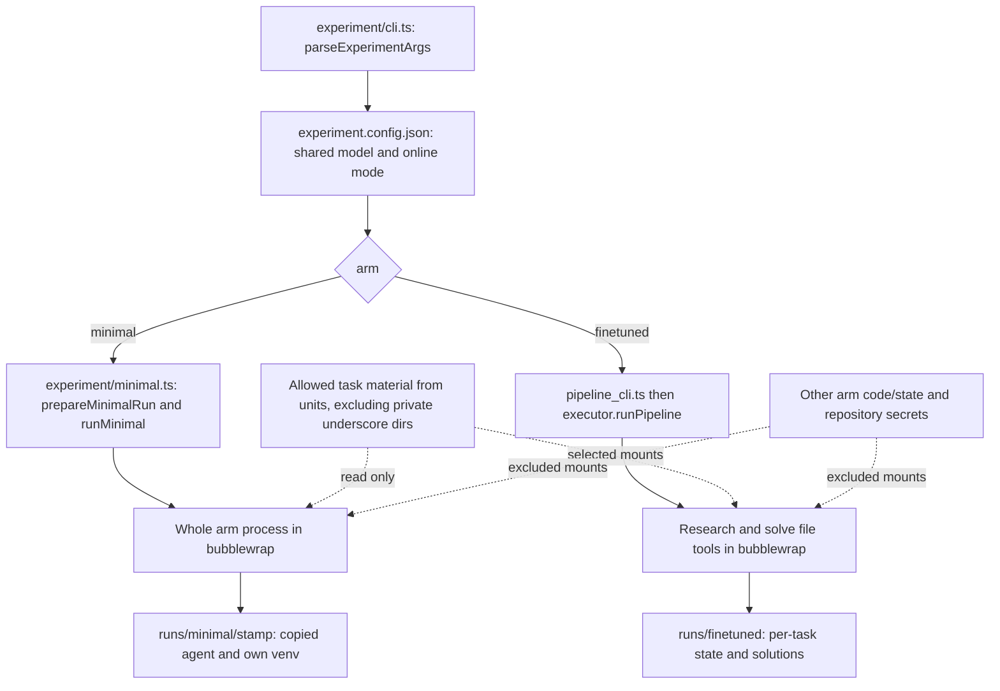
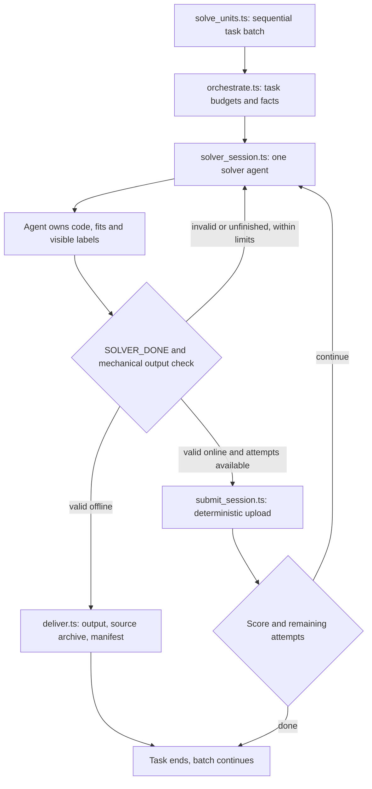
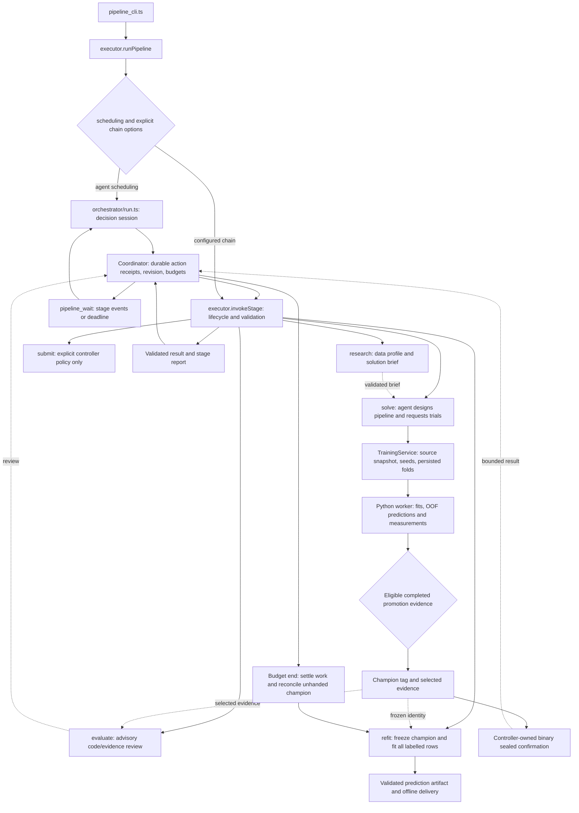
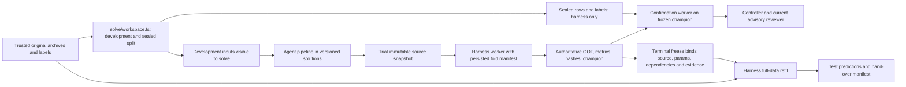
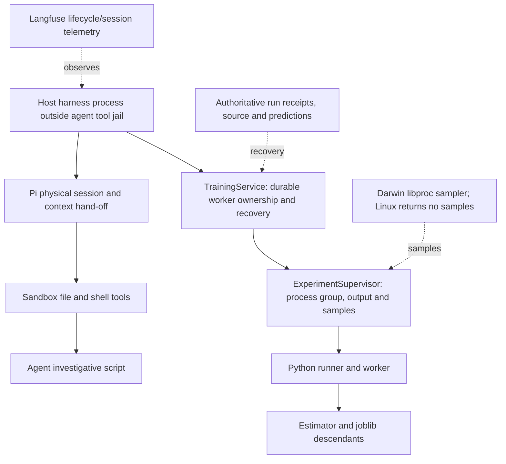
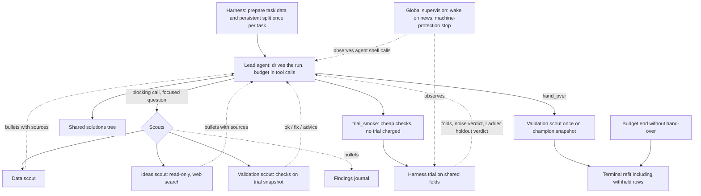

# Architecture and flow

[Work queue](cleanup-plan.md) · [Decisions](adr/README.md) · [Source inventory](code-inventory.md)

All **CURRENT** diagrams describe the code that runs today, including P3 run
mechanics. The accepted v2 design
([expert-team-v2.md](../harness/finetuned/docs/expert-team-v2.md)) is not
implemented; its run shape is at the end of this page. The
[generated inventory](code-inventory.md) identifies the measured source bytes.
Dashed links describe access or feedback, not automatic stage
succession. Stage names are capabilities selected by the controller; arrows
give a common local route, not a mandatory fixed workflow.

## Module boundaries and review map

| Boundary | Owns | Key source / contract |
| --- | --- | --- |
| Experiment host | Arm dispatch, shared configuration, run preparation | [cli.ts](../experiment/cli.ts), [config.ts](../experiment/config.ts), [minimal.ts](../experiment/minimal.ts) |
| Pipeline executor | Stage lifecycle, typed artifacts, validation, preflight | [executor.ts](../harness/finetuned/agent/pipeline/executor.ts), [types.ts](../harness/finetuned/agent/pipeline/types.ts), [setup.ts](../harness/finetuned/agent/pipeline/setup.ts) |
| Controller | Decisions, durable budgets/actions and artifact catalog | [orchestrator README](../harness/finetuned/agent/orchestrator/README.md) |
| Research | Deterministic dataset profile and agent-authored brief validation | [profile.ts](../harness/finetuned/agent/research/profile.ts), [validate.ts](../harness/finetuned/agent/research/validate.ts) |
| Solve / training | Agent trial requests versus harness execution and promotion | [solve session](../harness/finetuned/agent/run/harness_solve_session.ts), [training README](../harness/finetuned/agent/training/README.md) |
| Confirmation / evaluation | Hidden independent check versus advisory model review | [confirmation service](../harness/finetuned/agent/confirmation/service.ts), [reviewer.ts](../harness/finetuned/agent/evaluation/reviewer.ts) |
| Refit / submit | Terminal full-data predictions versus separately authorized upload | [refit service](../harness/finetuned/agent/refit/service.ts), [submit stage](../harness/finetuned/agent/pipeline/stages/submit.ts) |
| Session / context | Physical sessions, explicit prompts, logical hand-offs | [session runner](../harness/finetuned/agent/run/session_runner.ts), [context README](../harness/finetuned/agent/context/README.md) |
| Knowledge | Reusable lessons, references to experiments and notes | [knowledge README](../harness/finetuned/agent/knowledge/README.md) |
| Telemetry | Shared run/invocation observations; does not replace recovery state | [telemetry contract](../harness/finetuned/docs/telemetry.md) |
| Scorecard | Finished-run evidence and explicit unavailable indicators | [scorecard README](../harness/finetuned/agent/scorecard/README.md) |

## CURRENT experiment dispatch and isolation

Evidence: [parseExperimentArgs / dispatch](../experiment/cli.ts), [minimal adapter](../experiment/minimal.ts), [prepareResearchSandbox](../harness/finetuned/agent/run/solve_sandbox.ts), [research boundary tests](../harness/finetuned/agent/run/research_sandbox.test.ts), [minimal boundary tests](../experiment/minimal.test.ts). Evaluate and controller have controller tools rather than unrestricted file tools. This is a tool/process boundary; trusted harness code runs outside agent jails.

## CURRENT minimal flow

Source: [batch](../harness/minimal/agent/run/solve_units.ts), [task loop](../harness/minimal/agent/run/orchestrate.ts), [session](../harness/minimal/agent/run/solver_session.ts), [checkCsv / checkToken](../harness/minimal/agent/run/output_check.ts), [delivery](../harness/minimal/agent/run/deliver.ts). Finetuned promotion rules do not apply to this arm. The mechanical check is not a statistical quality assessment.

## CURRENT finetuned controller, stages and trials

[Registry.getStage](../harness/finetuned/agent/pipeline/registry.ts) is authoritative. [startStageInvocation / invokeStage / runPipeline](../harness/finetuned/agent/pipeline/executor.ts) own lifecycle and validation, with [setup](../harness/finetuned/agent/pipeline/setup.ts) before sessions. [Coordinator](../harness/finetuned/agent/orchestrator/coordinator.ts) controls actions; [state](../harness/finetuned/agent/orchestrator/state.ts) persists identity and counters. A finished session does not establish artifact validity.

[TrainingService](../harness/finetuned/agent/training/service.ts), [worker](../harness/finetuned/agent/training/python/worker.py), [search implementation](../harness/finetuned/agent/training/python/smartlab_trial/search.py) and [pairedPromotion](../harness/finetuned/agent/training/promotion.ts) own evidence. When no champion exists, initialization selects the best eligible open trial. To replace an existing champion, the paired lead must be positive and exceed two standard errors on identical persisted folds; a standalone score or advisory readiness is insufficient. See [runConfirmation](../harness/finetuned/agent/confirmation/service.ts), [evaluation evidence](../harness/finetuned/agent/evaluation/evidence.ts), [terminal refit](../harness/finetuned/agent/refit/service.ts) and [delivery](../harness/finetuned/agent/refit/delivery.py).

**P3 is current runtime**, integrated in fd96ccd: waits use events/deadlines without percentage notices or model polling, counters reconcile workers actually launched (pre-spawn validation is not charged), interrupted solves release unused reservations, and budget exhaustion can trigger deterministic terminal hand-over. Champion reconciliation and recovered refits crossing the deadline are covered by its review fixes. Detached runs print event progress. No upload occurs at budget end. Configured chains never automatically reach submit, even if available. Follow-up solves branch from the champion through [branches.ts](../harness/finetuned/agent/training/branches.ts); the future design additionally specifies merging successful follow-ups into the base.

## CURRENT source, evidence and sealed-data boundaries

[prepareSolveWorkspace](../harness/finetuned/agent/solve/workspace.ts) and [folds](../harness/finetuned/agent/solve/folds.ts) prepare split data; [terminal identity](../harness/finetuned/agent/training/terminal.ts) and [confirmation receipts](../harness/finetuned/agent/confirmation/receipt.ts) bind evidence. Sealed data enters training only after terminal freeze; it cannot then be independent confirmation. Current repeated split preparation is not the planned durable task-level configuration guard. Current code review reads live source ([code.ts](../harness/finetuned/agent/evaluation/code.ts)); executing checks against the trial snapshot is a future P6/P7 requirement. Non-binary confirmation currently skips. There is no automatic scrubber that removes sealed numbers from controller-authored guidance.

Prompts are selected explicitly via [registry](../harness/finetuned/agent/prompts/registry.ts) and [loader](../harness/finetuned/agent/prompts/loader.ts), snapshotted with content/message hashes. [runSession](../harness/finetuned/agent/run/session_runner.ts) disables ambient context files. Prompt provenance, typed input metadata, measured trial evidence and Langfuse traces answer different review questions; none replaces the others.

## CURRENT process and resource ownership

[Supervisor](../harness/finetuned/agent/experiments/supervisor.ts), [ownership](../harness/finetuned/agent/experiments/ownership.ts), [sampler](../harness/finetuned/agent/experiments/sampler.ts), [runner](../harness/finetuned/agent/training/python/runner.py). The generic supervisor is used by harness workers; its opt-in tools are not a universal observer of current agent shell commands. Research still has a bash timeout. The sampler returns no samples on Linux, so CPU/RSS-based stall and memory signals do not work on this host today. There is no shared RAM pool and no machine-protection stop yet; v2 section 6 plans one with its own sampler, because the deferred P1 investigation showed kernel OOM ordering cannot be controlled without privileges ([ADR 003](adr/003-finite-ram-observation.md)). Context-token hand-offs are separate from process RAM.

## ACCEPTED v2 DESIGN, NOT IMPLEMENTED: lead agent and scouts

This is [expert-team-v2.md](../harness/finetuned/docs/expert-team-v2.md) sections 2–6, **not current runtime**. There is no LLM orchestrator and no fixed stage order; the lead decides when to call scouts, start trials and hand over. Labels of withheld rows are never shown; on a new champion the lead hears only a rounded Ladder verdict. P6 foundations come first, then P7a (lead and scouts) and P7b (harness services), then the integration gate and P7c. Contracts kept from the first design are in [expert-team.md](../harness/finetuned/docs/expert-team.md). [ADR 007](adr/007-lead-and-scouts.md) records the decision.
