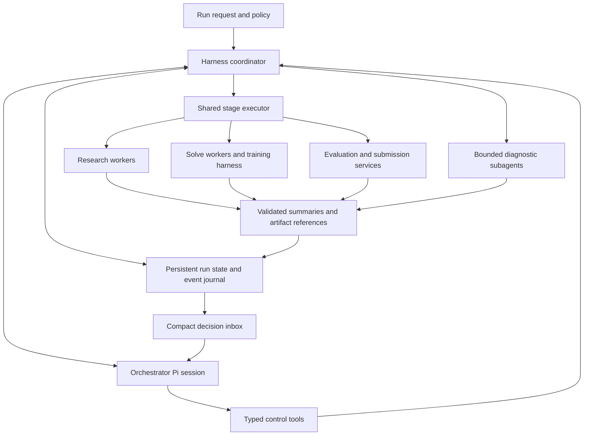

# Agent-directed pipeline architecture

Status: implemented core decision loop, 2026-10-07. The original design below
remains the broader target; the implementation scope and limits follow here.

## Implemented scope

The Pi decision loop, durable local coordinator, narrow tools and shared-executor
integration are implemented in `agent/orchestrator/`. See its
[actual runtime APIs and limits](../agent/orchestrator/README.md). The explicit
`npm run orchestrate -- unit 1 task 1 --goal 1` command selects actions dynamically.
Configured scheduling remains compatible and never grants submission permission.
Submission is registered deterministic code with immutable controller policy and
GET-only restart reconciliation. The first two official aggregate results can guide
new independently validated candidates; the total task cap remains three and the
agent can stop earlier. Official best, development evidence and advisory review are
kept separate.

State and its append-only action journal are one checksummed atomic/fsynced
snapshot, with run/task-workspace kernel locks. Mutating tools use action IDs and
revisions; reserved invocation IDs dispatch through `startStageInvocation`. Prompt
and config snapshots, artifact snapshots/provenance, budgets, notification cursors,
unknown reservations and best official references survive handoff/restart. Physical
session/model/tool budgets use controller hooks on the existing session runner.
No ambient AGENTS/CLAUDE context, extensions, shell, dataset or upload tools are
exposed to the decision agent. Every physical session is observed under the root
control invocation and receives fresh durable state.

Lost in-memory module agents are marked interrupted, never falsely reattached.
The next solver reconciles its existing durable training root; other workspace
actions wait. Refit retains its existing freeze/worker recovery path. Submission
`mode: "reconcile"` never falls back to upload; unresolved/absent intents block new
effects. Read-only recovery precedes unrelated model preflight, and already met
goals/exhausted caps terminate with no new model session.

Deferred: diagnostic `analysis_delegate`/`analysis_result` (the existing child
manager is broad and non-durable), distributed ownership, a universal candidate
registry separate from training/refit records, and provider-internal HTTP retry
accounting. Global trial allocation is conservative and unused slots are not
refunded. The score target is a goal, not a guarantee or a requirement to upload
three times. The rest of this document describes the broader architecture target;
claims that the coordinator or submission are future work are historical.

## Objective

An orchestrator agent decides what should happen next. Stages and subagents do
the actual research, implementation, fitting, and inspection. The orchestrator
receives compact outcomes and requests detail only when it affects a decision.
It can ask for improvements, wait for useful evidence, stop work, or submit a
qualified candidate within the run's permissions and budgets.

The existing executor remains responsible for executing and validating stages.
Replace the fixed scheduling policy, not the harness-owned training contract.

This plan builds on [pipeline integration](pipeline-integration.md),
[harness-owned training](harness-owned-training.md), and the goals in
[autonomous experimentation](autonomous-experimentation-plan.md). Historical
implementation findings in earlier plans must be rechecked before migration.

## Existing foundation and gaps

| Area | Available now | Required addition |
| --- | --- | --- |
| Execution | `invokeStage`, minimal `startStageInvocation` handles, registered research/solve/evaluate/refit, typed options and artifact validation | Durable coordinator ownership and agent-directed scheduling |
| Context | `SmartContextSession`, short artifact-oriented handoff, physical session links | Automatic attachment of persistent pipeline state to each successor |
| Delegation | Scoped child manager, bounded replies, follow-ups, parent rebinding | Typed findings and routing into the orchestrator's decision inbox |
| Training | Harness-owned trials, fold evidence, eligibility and result collection | Durable candidate references and explicit improvement requests across invocations |
| Setup | Stage prerequisite declarations and preflight | Requirements for dynamically available actions and added integrations |
| Observability | Shared identities, local events, optional database | Decision events, summary lineage, action accounting; optional Langfuse adapter |
| Submission | Legacy upload and status code | Registered evaluation/submission stages, frozen artifacts, durable attempt accounting |

Evaluation and deterministic terminal refit are registered. Submission remains unregistered and cannot be enabled. Langfuse
connectivity was tested, but pipeline-wide export is not integrated. Pi session
handoffs work within a running host; host-crash recovery is additional work.

## Responsibilities

The orchestrator chooses objectives and actions. It receives no general shell,
file-read, file-write, dataset, training, or upload tool. A typed detail tool can
return bounded artifact sections or measurements; larger investigations go to
a worker. This tool boundary reduces context growth; it is not a claim of
filesystem isolation for workers.

Stages own their workers, experiments, and artifact validation. Diagnostic
subagents can inspect a bounded question and recommend an action, but cannot
promote a model or submit it. Solver agents retain freedom over features,
estimators, hyperparameters, and fold design. An orchestrator improvement request
states the observed problem and desired investigation, not a prescribed model.

The deterministic coordinator owns identities, budgets, validation, concurrency,
state persistence, and scheduling accepted commands. It outlives individual Pi
sessions. Only it can issue executor invocations or submission operations.

## Persistent run state

Create `runs/<task>/pipeline/<run-id>/state.json` plus a durable action journal.
Use versioned schemas, atomic snapshots, a single-writer run lock, and revisions
for optimistic concurrency. Retain the existing observability stream separately;
a telemetry failure must not lose authoritative action or submission state.

The state contains:

- Run ID, task/dataset fingerprint, immutable configuration and prompt snapshots.
- Allowed actions, submission policy, and reserved/consumed/remaining budgets.
- Stage invocations: ID, objective, status, upstream artifact references, worker
  handles, cancellation requests, and validated completion outcome.
- Candidate IDs with source snapshot, request, evidence and artifact hashes;
  distinguish measured, eligible, selected, frozen, and submitted states.
- Active experiments and diagnostic children, logical owner, spawn parent,
  current physical parent, status, and latest compact result reference.
- Pending decisions, accepted action IDs, notification cursor, and explicit
  terminal or blocked reason.

Paths alone are insufficient evidence. Bind artifacts to their producer,
candidate, dataset and content hash; a changed `solutions/` file must not silently
change the meaning of an already-measured candidate.

Sessions reconstruct state through tools. The handoff does not serialize this
state again and is never its source of truth.

## Orchestrator tool interface

All mutating requests include an action ID and expected state revision. Repeating
an accepted action ID returns its existing handle; a stale revision returns a
compact conflict plus the current revision. Authorizations come from run policy,
not model-generated flags.

| Tool | Request | Bounded response |
| --- | --- | --- |
| `pipeline_status` | Optional notification cursor | Current stage work, selected candidate, budgets, blockers and pending decisions |
| `stage_start` | Stage, objective, upstream artifact IDs, option overrides | Accepted invocation ID or factual rejection |
| `stage_status` | Invocation ID | Current status and latest validated summary |
| `stage_feedback` | Invocation ID, message, evidence references | Queued delivery ID; explicit refusal if feedback is unsupported |
| `stage_cancel` | Invocation ID, reason | Cancellation requested; terminal state arrives later |
| `analysis_delegate` | Bounded question, artifact IDs, expected findings | Child handle |
| `analysis_result` | Child handle | Findings, uncertainty, artifact references and recommended action |
| `artifact_inspect` | Artifact ID, typed section/filter, page cursor | Bounded content with provenance and continuation cursor |
| `pipeline_wait` | Cursor and maximum wait | Significant changes since cursor, or timeout |
| `pipeline_finish` | Outcome and reason | Terminal transition, once owned work has settled or been cancelled |

`stage_start` is the controlled entry to `invokeStage`; submission is an invocation
of a registered deterministic stage, not an agent-operated HTTP client.
The module-side executor/runner interface now supports bounded typed guidance
and factual feedback via `startStageInvocation` handles and the stable logical
session facade (see [the current API](pipeline-integration.md#invocation-guidance-and-live-feedback)).
This supplies local invocation ownership and delivery receipts; the durable
coordinator, action journal, budgets and agent loop described here remain future work. If a
stage has already finished, request another invocation with explicit upstream
artifacts and a new objective instead of pretending its session is still active.

## Small context by construction

A stage returns a validated, versioned summary with:

- Invocation, task, dataset, and candidate identity.
- Outcome and artifact validation status.
- Authoritative measurements with scope, coverage, metric direction, and evidence
  references. Include a comparison only if the harness verified comparability.
- Material change from the previous accepted result.
- Blockers, remaining work, and any decision needed.
- Artifact references for deeper inspection.

Keep agent recommendations separate from harness-measured fields. Completion of
a worker session is not stage success. Missing or malformed summaries are
reported as such, never converted into a confident success message.

Use schema-aware bounds per field, paginated artifact references, and a recorded
truncation indicator. Never truncate serialized JSON or drop mandatory validation
failures to meet a byte cap. Store full reports and transcripts outside the
orchestrator context.

Notify the orchestrator on validation failure, completed useful evidence,
material comparison results, blocked work, budget changes, and terminal outcomes.
Coalesce routine updates per invocation. Preserve terminal events and acknowledge
notifications by cursor so handoffs do not lose or replay decisions. The worker
continues receiving detailed fold updates; the orchestrator does not receive
those by default. No periodic model calls merely to ask whether work finished.

Add orchestrator limits and summary/detail/notification sizes to
`harness.config.json`. Keep `solve.experimentUpdateIntervalSeconds` specific to
worker fold observation; it is not the orchestrator's polling interval. Choose
production summary limits from probe measurements rather than imposing a fixed
word target on every reply.

## Task-specific stage guidance

Authored stage prompts stay broad enough for every task: classification or
not, with or without a train/test difference. The orchestrator specializes
them per task. At task start it reads the task description and writes a short
guidance note for each stage it plans to run, for example which train/test
comparisons matter for this task's input format or what the target is. It can
revise a note later from validated stage results, such as research reporting a
vocabulary shift that solve should account for.

- Guidance is typed run data, not a prompt edit. It never modifies files in
  `agent/prompts/`. Stage prompts expose one optional guidance variable, and
  `stage_start` passes a guidance reference.
- Each note is stored in run state with an ID, version, content hash, author
  session, and the evidence it cites. Observability records it as a supplied
  input, separate from prompt identity, so comparisons can tell base
  instruction changes from task refinements.
- A note is fixed for an invocation's lifetime. A revision applies to the next
  invocation, not mid-session.
- Guidance can narrow or prioritize work but cannot relax harness contracts:
  sealed data, evidence and validation rules, budgets, and submission policy
  still come from the base prompts and the coordinator.
- Without an orchestrator, or with no note, stages run on the base prompts
  alone. Configured scheduling keeps working unchanged.

## Decision loop and execution rules

1. Resolve the task, enabled capabilities and run policy; perform shared preflight.
2. Attach current run state and pending notifications to an observed orchestrator
   session with explicitly selected prompts.
3. The agent inspects status and requests an action, delegates a question, waits,
   or finishes. Record a short decision explanation and evidence references.
4. The coordinator validates the request and atomically reserves its budget and
   action ID before starting work through the executor.
5. Workers execute independently. Their validated results update persistent state
   and the compact inbox; the orchestrator makes its next decision from that state.

Support `configured` scheduling for compatibility and an opt-in `agent` mode.
Stage `next` remains a default only for configured scheduling. Dynamic scheduling
still enforces prerequisites, such as a validated research artifact for solve and
frozen submission artifacts for submit. This is dependency validation, not a
hardcoded order for every run.

Initially permit one mutating stage per task/workspace, with bounded read-only
diagnostic children in parallel. Do not run competing writers against shared
`solutions/`. Later parallel candidate development needs separate snapshots or
workspaces and explicit artifact reconciliation. Reserve model, trial, wall-time,
and submission budgets before concurrent actions; handoffs never reset budgets.

On repeated failures or exhausted budgets, settle the run with a recorded reason.
Do not spin an unrestricted model loop on unchanged evidence. Retrying a stage
must reference the previous failure and satisfy a bounded retry policy.

## Handoff and parent continuity

At the configured threshold, finish the current tool batch, ask for the short
handoff without tools, and create a new observed Pi session. Today 5k is a test
setting; restore the normal operating value after the probes.

The coordinator retains ownership of active stage invocations and child scopes.
Every new session receives the same logical orchestrator/run identity, a compact
current status reference, and the notification cursor. Physical agent-run and Pi
session IDs change and are linked by handoff events.

The handoff supplies only pointers, the unfinished next step, and important
conversation-only intent. The successor reads `pipeline_status` before taking an
action. Completed actions are not repeated merely because the original request
appears in its prompt.

Existing children retain their spawn-parent ID for provenance. Rebind the live
scope to the new physical parent for future spawns and current-owner events.
The successor can collect existing results through the same manager. Current
subagent result delivery is pull-based; a new decision inbox adds notifications
without replaying child transcripts. Stage worker parents remain their stage
workers, not the orchestrator's latest physical session.

Host recovery is distinct from context handoff. After a coordinator restart,
reconcile durable invocation handles with actual process/artifact state. A lost
in-memory Pi child is marked interrupted and can be restarted explicitly; do not
claim it was reattached. Unknown submission status requires remote reconciliation
before any retry. Active process handles need their own recovery protocol before
unattended host restart is supported.

## Evaluation and submission boundary

Implement evaluation and submission before exposing those actions to the agent.
Reuse audited transport/status helpers, not the legacy automatic solve/evaluate/
submit loop. The orchestrator decides whether further work is worthwhile; the
harness decides whether the requested action is eligible.

Evaluation validates the selected candidate's evidence and produces an explicit
verdict. Final preparation freezes source, parameters, dependencies, seed lineage,
and evidence, then invokes harness-owned terminal refitting to generate predictions.
Keep sealed confirmation data unavailable to orchestrator and solver agents. Follow
the training contract: after sealed rows join terminal refitting, they cannot
supply independent validation for further improvement of that candidate.

Submission accepts only an immutable, validated prediction/source bundle bound
to the frozen candidate. Enforce task identity, format, source allowlist, attempt
budget, and the run's submission policy. A no-submit test run cannot enable
uploads through a tool argument. An authorized autonomous run needs no new routine
human approval for each permitted submission.

Persist an attempt intent before upload and its receipt afterward. If the network
fails after sending, mark the outcome unknown and query remote attempts. Never
blindly retry or promise exactly-once upload without server support. Expose official
scores and remaining attempts as typed results, distinct from development metrics.

## Setup, prompts and observability

In agent mode, preflight the explicitly enabled capabilities available to that
run, since there is no fixed future stage chain. Recheck action-specific resources
when invoked. Disabled submission or unused providers do not require credentials.
Register every new dependency through stage setup requirements and regression tests,
as required by AGENTS.md. Check remote submission status read-only during setup.

Store orchestrator system, opening, feedback and tool prompts in
`agent/prompts/orchestrator/` with the existing registry and snapshot mechanism.
Keep automatic development context loading disabled. Session-construction tests
must retain the distinctive AGENTS.md exclusion marker check.

Record decisions, action acceptance/rejection, state revisions, budget reservations,
summary provenance, inbox delivery/acknowledgement, and handoff links under the
shared run/invocation identities. Record full messages in observability without
feeding them back into orchestrator context. Do not record credentials. A future
Langfuse adapter exports these same events and authoritative scores; it is not
needed for scheduling correctness.

## Proposed implementation layout

| Location | Responsibility |
| --- | --- |
| `agent/orchestrator/types.ts` | State, commands, summaries, decision and notification schemas |
| `agent/orchestrator/store.ts` | Journal, atomic snapshots, revisions, action deduplication |
| `agent/orchestrator/coordinator.ts` | Session-independent ownership, budgets, dispatch and reconciliation |
| `agent/orchestrator/tools.ts` | Narrow control tools and bounded result shaping |
| `agent/orchestrator/session.ts` | Shared observed runner and context continuation |
| `agent/orchestrator/inbox.ts` | Significant events, coalescing, cursors and acknowledgements |
| `agent/prompts/orchestrator/` | Authored instructions and tool descriptions |
| `agent/pipeline/executor.ts` | Common lifecycle and validation for both scheduling modes |
| `agent/pipeline/stages/` | Research, solve, and future evaluate/submit adapters |

Avoid a second execution implementation inside the orchestrator. Refactor the
existing executor to expose run-scoped invocation ownership while preserving its
standalone entry points and event contract.

## Delivery sequence and acceptance

1. **Persistent control state and summaries.** Add the state/journal schemas,
   validated summary adapters, budget reservations and asynchronous handles.
   Keep configured scheduling. Tests prove state replay, artifact provenance,
   action deduplication, and failure before side effects on persistence errors.
2. **Orchestrator without submission.** Add agent scheduling, narrow tools, and
   diagnostic delegation. A fixed local task must run research/solve, request a
   measured improvement, wait without busy polling, and stop on validation/budget
   rules. Unsupported evaluation/submission actions must be rejected.
3. **Continuity and inbox.** Probe a parent handoff while a stage and a child run.
   Both results must reach the replacement session under the original invocation;
   subsequent children use the new parent ID. Repeat a queued action across the
   handoff and prove it executes only once. Verify no transcript replay and test
   cancellation, duplicate notifications, and oversized summaries.
4. **Evaluation and terminal preparation.** Register deterministic artifact checks
   and final refit against fixed fixtures. Reject stale hashes, incompatible
   evidence and post-refit sealed-score reuse. A worker claiming success alone
   must never pass the stage.
5. **Submission integration.** Test with a mock server, including accepted upload
   followed by timeout, process interruption, and attempt reconciliation. Verify
   no-submit policy with a server asserting zero upload calls. Real uploads remain
   off until explicitly running an authorized submission workflow.
6. **Operational recovery and comparison.** Test host interruptions and bounded
   resume behavior. Compare configured versus agent scheduling on fixed tasks,
   measuring orchestrator input/output tokens, worker tokens, context per decision,
   duplicate actions, valid completion rate, training cost and result quality.

Initial scope: one task per orchestrator, one mutating stage at a time, bounded
parallel diagnostics, local durable state, and no automatic submission. Wider
concurrency and Langfuse export are separate increments. This keeps the first
probe focused on whether delegation improves decisions while reducing context.
